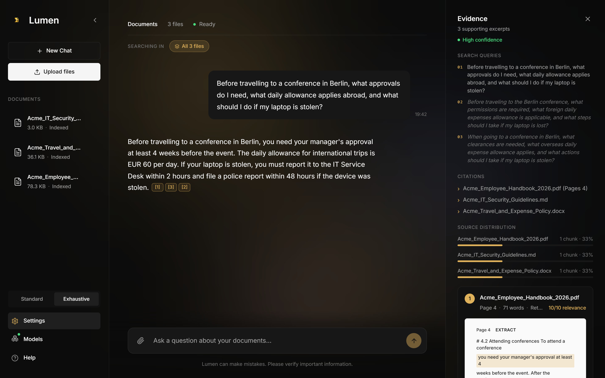
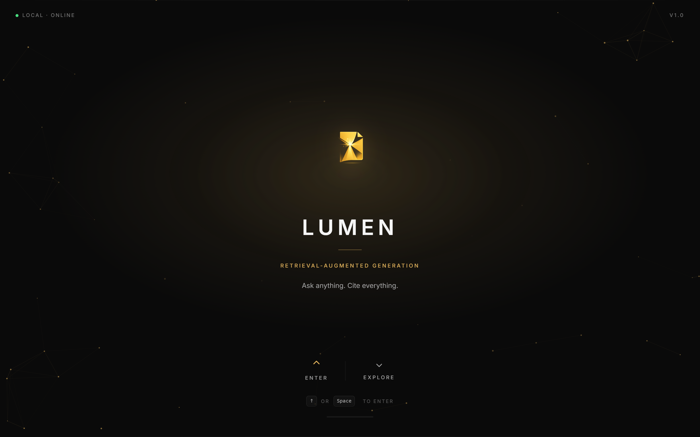
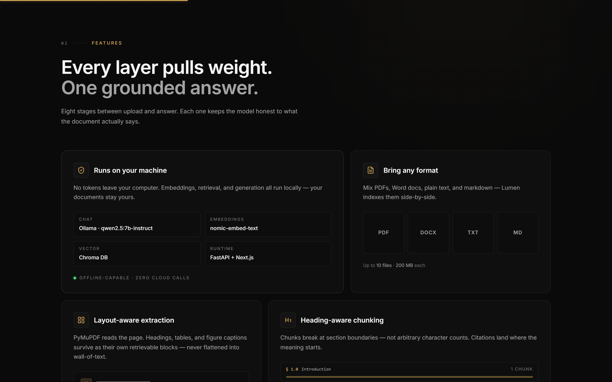
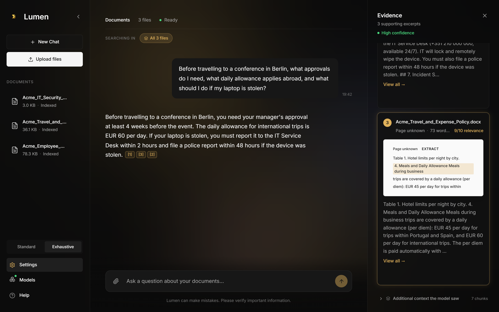
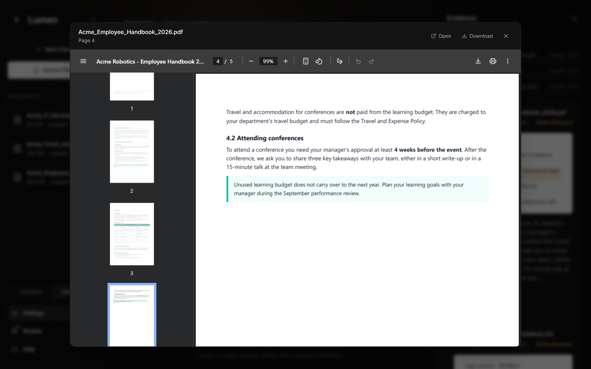
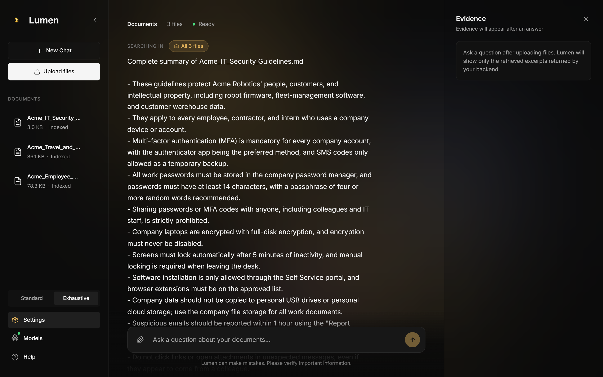

# Lumen - Local Document Q&A with Retrieval-Augmented Generation

Lumen is a local-first research assistant for your own documents. Upload
PDF, DOCX, TXT or Markdown files and ask questions about them in natural
language. Every answer is grounded in passages retrieved from your files
and comes with citations (file and page) that you can click to check the
original text.

Everything runs on your own computer: the chat model and the embedding
model are served by [Ollama](https://ollama.com), the vectors are stored in
ChromaDB, the RAG pipeline is exposed by a FastAPI backend and the
interface is a Next.js web app. No document or question is sent to a
cloud API.



---

## Table of contents

1. [Features](#features)
2. [Screenshots](#screenshots)
3. [Tech stack](#tech-stack)
4. [Requirements](#requirements)
5. [Installation](#installation)
6. [Running the app](#running-the-app)
7. [Using the app](#using-the-app)
8. [RAG pipeline overview](#rag-pipeline-overview)
9. [Project structure](#project-structure)
10. [HTTP API](#http-api)
11. [Configuration](#configuration)
12. [Troubleshooting](#troubleshooting)
13. [Known limitations](#known-limitations)

---

## Features

- **Fully local.** The chat model and the embedding model run through
  Ollama on your machine. Your documents never leave it.
- **Mixed formats.** PDF, DOCX, TXT and Markdown, up to 10 files of
  200 MB each, indexed side by side.
- **Layout-aware PDF extraction.** PyMuPDF keeps headings, tables and
  figure captions as separate retrievable blocks. Scanned PDFs can be
  read with an optional OCR fallback (Tesseract).
- **Hybrid retrieval.** Dense vector search (MMR) and BM25 keyword
  search, fused with Reciprocal Rank Fusion (RRF).
- **Smarter queries.** Follow-up questions are rewritten using the chat
  history, and every question is expanded into 3 search queries.
- **CrossEncoder reranking.** A small cross-encoder
  (`ms-marco-MiniLM-L-6-v2`) re-scores the candidates before the answer
  is generated, with an LLM fallback.
- **Two answer modes.** *Standard* gives a short answer; *Exhaustive*
  gives a detailed answer with inline `[N]` citations that are validated
  and renumbered on the server.
- **Evidence panel.** Shows the search queries used, the cited files and
  pages, the source distribution, every retrieved excerpt with its
  relevance score, and the extra context the model saw.
- **Source preview.** Opens the original PDF at the cited page, so any
  claim can be checked in its original layout.
- **Document scope and summaries.** Restrict a question to selected
  files, or summarize every active document with one click.
- **Streaming.** Answer tokens appear as the model generates them.

---

## Screenshots

The screenshots use the sample documents in
[`docs/sample_documents`](docs/sample_documents) (a fictional company).

| | |
|---|---|
|  |  |
| Landing page | Feature overview |
|  |  |
| Clicking a citation highlights the supporting excerpt | The original PDF opens at the cited page |
|  | |
| One-click summary of every document | |

---

## Tech stack

| Layer | Technology |
|---|---|
| Chat model | `qwen2.5:7b-instruct` through Ollama |
| Embeddings | `nomic-embed-text` through Ollama |
| Vector store | ChromaDB |
| Keyword search | rank-bm25 |
| Reranker | sentence-transformers CrossEncoder (`cross-encoder/ms-marco-MiniLM-L-6-v2`) |
| Orchestration | LangChain |
| Document parsing | PyMuPDF, pypdf, python-docx, Tesseract OCR (optional) |
| Backend | Python, FastAPI, Uvicorn |
| Frontend | Next.js 14, React 18, TypeScript, Tailwind CSS, Framer Motion |

---

## Requirements

| Tool | Version | Notes |
|---|---|---|
| [Python](https://www.python.org/downloads/) | 3.10 to 3.14 | Tested on 3.12, 3.13 and 3.14 |
| [Node.js](https://nodejs.org/) | 18.17 or newer (LTS recommended) | npm is included. Tested on Node 24 |
| [Ollama](https://ollama.com/download) | Recent version | Runs the language models |
| [Git](https://git-scm.com/downloads) | Any | Optional, you can also download the ZIP |
| [Tesseract OCR](#7-optional-install-tesseract-ocr-for-scanned-pdfs) | Any | Optional, only for scanned PDFs |

Hardware and network:

- **RAM:** 16 GB recommended. With 8 GB, use a smaller chat model (see
  [Configuration](#configuration)).
- **Disk:** about 5 GB for the Ollama models and 2 GB for the Python
  packages.
- **GPU:** optional. Ollama uses an NVIDIA or AMD GPU, or Apple Silicon,
  automatically. On CPU only, answers are slower.
- **Internet:** only needed to install everything and on the first run,
  when the reranker model (about 90 MB) is downloaded. After that the app
  works offline.

The project was developed on Windows 11 and also runs on macOS and
Linux. The commands below show both versions where they differ.

---

## Installation

### 1. Install the prerequisites

1. **Python** from <https://www.python.org/downloads/>. On Windows, tick
   **"Add python.exe to PATH"** in the first screen of the installer.
2. **Node.js** (LTS version) from <https://nodejs.org/>.
3. **Ollama** from <https://ollama.com/download>. On Windows and macOS it
   keeps running in the background after installation (icon in the
   system tray / menu bar). On Linux, start it with `ollama serve` if it
   is not running as a service.

Open a new terminal and check that everything is available:

```powershell
python --version    # macOS / Linux: python3 --version
node --version
ollama --version
```

### 2. Download the project

```bash
git clone https://github.com/1230692/RAG_IAAPL_Project.git
cd RAG_IAAPL_Project
```

Without Git: on the GitHub page click **Code > Download ZIP**, extract it
and open a terminal inside the extracted folder (`RAG_IAAPL_Project-main`).

All the following commands are run from this project folder.

### 3. Download the Ollama models

```bash
ollama pull qwen2.5:7b-instruct
ollama pull nomic-embed-text
```

`qwen2.5:7b-instruct` (about 4.7 GB) generates the answers and
`nomic-embed-text` (about 270 MB) creates the embeddings used to index
the documents.

### 4. Install the Python backend

Create a virtual environment and install the dependencies into it. The
commands call the Python inside `venv` directly, so there is no need to
activate the environment.

**Windows (PowerShell):**

```powershell
python -m venv venv
.\venv\Scripts\python.exe -m pip install --upgrade pip
.\venv\Scripts\python.exe -m pip install -r requirements.txt
```

**macOS / Linux:**

```bash
python3 -m venv venv
venv/bin/python -m pip install --upgrade pip
venv/bin/python -m pip install -r requirements.txt
```

The first installation takes a few minutes (it downloads PyTorch,
ChromaDB, LangChain and the other libraries).

> **Linux tip:** on Linux, the default PyTorch package includes the CUDA
> libraries and is several GB. The reranker runs fine on CPU, so you can
> install the much smaller CPU build **before** the requirements:
> `venv/bin/python -m pip install torch --index-url https://download.pytorch.org/whl/cpu`

### 5. Install the frontend

```bash
cd frontend
npm install
cd ..
```

npm may print warnings about deprecated packages or audit findings. They
do not prevent the app from running.

### 6. (Optional) Create the configuration files

Both files are optional. The defaults work out of the box.

- `.env` in the project root: choose other Ollama models. Copy the
  example file and edit it:

  ```powershell
  Copy-Item .env.example .env    # macOS / Linux: cp .env.example .env
  ```

- `frontend/.env.local`: only needed if the backend does **not** run on
  port 8000 (see [Troubleshooting](#troubleshooting)).

### 7. (Optional) Install Tesseract OCR for scanned PDFs

Image-only PDFs (for example, scanned reports) have no extractable text,
so their pages go through an OCR pass. The Python wrapper is already
installed; the Tesseract program itself must be installed separately:

- **Windows:** download the installer from
  <https://github.com/UB-Mannheim/tesseract/wiki>. During the
  installation, tick the **Portuguese** language pack if you need it.
  Then add the install folder (by default
  `C:\Program Files\Tesseract-OCR`) to the `Path` environment variable
  and open a new terminal.
- **macOS:** `brew install tesseract tesseract-lang`
- **Linux (Debian / Ubuntu):** `sudo apt install tesseract-ocr tesseract-ocr-por`

Check it with `tesseract --version`. Without Tesseract, text-based PDFs
still work; only scanned pages come back empty.

---

## Running the app

You need **two terminals**, both opened in the project folder, and
Ollama running in the background.

### Terminal 1 - backend (FastAPI)

**Windows:**

```powershell
.\venv\Scripts\python.exe -m uvicorn backend.main:app --host 127.0.0.1 --port 8000
```

**macOS / Linux:**

```bash
venv/bin/python -m uvicorn backend.main:app --host 127.0.0.1 --port 8000
```

Wait for `Application startup complete`. Useful links:

- Health check: <http://localhost:8000/api/health>
- Interactive API documentation (Swagger): <http://localhost:8000/docs>

While developing, add `--reload` to restart the server automatically when
Python files change.

### Terminal 2 - frontend (Next.js)

```bash
cd frontend
npm run dev
```

Then open **<http://localhost:3000>** in your browser.

For a faster, production-like frontend, run `npm run build` once and then
`npm run start` instead of `npm run dev`.

To stop the app, press `Ctrl + C` in both terminals.

---

## Using the app

1. On the landing page, click **Enter** (or press `Space`).
2. Click **Upload files** in the sidebar and choose one or more PDF,
   DOCX, TXT or MD files. Wait for the *Indexed N file(s)* message.
3. Type a question in the box at the bottom and press `Enter`.
4. Choose the answer mode in **Settings** (bottom of the sidebar):
   - *Standard*: a short answer in a few sentences. The Evidence panel
     still lists the retrieved excerpts.
   - *Exhaustive*: a detailed answer with `[N]` citation chips whose
     numbers match the cards in the Evidence panel.
5. Click a `[N]` chip to jump to the excerpt that supports it. Hover an
   Evidence card and click **Open in source** to see the original PDF at
   the cited page.
6. Click a document in the sidebar to restrict the search to it; click
   it again to search all documents. The *Searching in* label above the
   chat shows the current scope.
7. Click **Summarize** in the suggestion banner (shown after an upload
   or a new chat) to get a bullet-point summary of every document.
8. The **Models** panel in the sidebar shows the configured models and
   whether the backend is reachable.

The first question takes longer than the others: the models are loaded
into memory and the reranker model is downloaded once.

### Try it with the sample documents

[`docs/sample_documents`](docs/sample_documents) contains three short
documents from a fictional company, Acme Robotics, in three formats:

| File | Content |
|---|---|
| `Acme_Employee_Handbook_2026.pdf` | Hybrid work, time off, learning budget, equipment |
| `Acme_Travel_and_Expense_Policy.docx` | Booking rules, daily allowance, expenses |
| `Acme_IT_Security_Guidelines.md` | Passwords, devices, travelling, phishing |

Upload all three and try, for example:

- *Before travelling to a conference in Berlin, what approvals do I
  need, what daily allowance applies abroad, and what should I do if my
  laptop is stolen?* (Exhaustive mode)
- *How many days per week can I work remotely?*
- *How many vacation days can I carry over, and until when?*
- *How quickly must I report a phishing email?*

---

## RAG pipeline overview

The end-to-end flow when a user asks a question:

```
                                +--------------------+
       (upload time)            |  user question     |
                                +---------+----------+
       1. file_storage                   |
       2. pdf_extractor                  | 4. query rewriting
          (+ OCR fallback)               |    (history-aware) +
       3. document_loader                |    multi-query expansion
       4. chunking                       |
            |                            |
            v                            v
       Chroma collection           Generated queries
       + embeddings                  (3 variants)
            |                            |
            +-----------+----------------+
                        |
                        v
         5. hybrid retrieval (retrieval.py)
              - MMR vector search (per query)
              - BM25 keyword search (per query)
              - Reciprocal Rank Fusion across all lists
                        |
                        v
                Fused candidate pool
                        |
                        v
         6. reranking (reranking.py)
              - CrossEncoder ms-marco-MiniLM-L-6-v2
              - LLM fallback if the encoder is unavailable
                        |
                        v
                Top-N selected chunks
                        |
                        v
         7. neighbor expansion (standard mode only)
              - Previous/next chunk per survivor for fuller context
                        |
                        v
         8. context build + answer generation (generation.py)
              - Mode-aware prompt (standard vs exhaustive)
              - Exhaustive: numbered EVIDENCE IDs the LLM cites as [N]
              - Citation validation + retry loop (exhaustive only)
              - Stream answer tokens
                        |
                        v
         9. response shaping (formatting.py + pipeline.py)
              - Citation alignment: keep only chunks the answer cited
                and remap [N]s to a compact 1-based range
              - Context documents: chunks the LLM saw but did not cite
              - Confidence label (High / Medium / Low)
```

Each stage lives in its own module so the pipeline can be inspected,
tuned and tested independently:

| Stage | File | Class |
|---|---|---|
| File persistence | [src/rag/file_storage.py](src/rag/file_storage.py) | `FileStorage` |
| PDF layout extraction (+ OCR) | [src/rag/pdf_extractor.py](src/rag/pdf_extractor.py) | (module functions) |
| Document loading | [src/rag/document_loader.py](src/rag/document_loader.py) | (module functions) |
| Chunking | [src/rag/chunking.py](src/rag/chunking.py) | `DocumentChunker` |
| Vector store management | [src/rag/vector_store.py](src/rag/vector_store.py) | `VectorStoreManager` |
| Query rewriting | [src/rag/querying.py](src/rag/querying.py) | `QueryProcessor` |
| Hybrid retrieval | [src/rag/retrieval.py](src/rag/retrieval.py) | `HybridRetriever` |
| Reranking | [src/rag/reranking.py](src/rag/reranking.py) | `DocumentReranker` |
| Answer generation | [src/rag/generation.py](src/rag/generation.py) | `AnswerGenerator` |
| Context formatting | [src/rag/formatting.py](src/rag/formatting.py) | (module functions) |
| Prompts | [src/rag/prompts.py](src/rag/prompts.py) | (module constants) |
| Orchestration | [src/rag/pipeline.py](src/rag/pipeline.py) | `DocumentRAGPipeline` |
| Tuning knobs | [src/rag/config.py](src/rag/config.py) | `RAGConfig` |

---

## Project structure

```text
RAG_IAAPL_Project/
├── backend/                       # FastAPI HTTP layer
│   ├── main.py                    # App entry point + CORS
│   ├── schemas.py                 # Pydantic request/response models
│   ├── api/
│   │   └── routes.py              # /api/* endpoints
│   └── services/
│       └── rag_service.py         # Process-level singleton: pipeline + state
│
├── src/                           # Pipeline source (importable as `src.rag`)
│   ├── utils.py                   # Logging, hashing, JSON IO
│   └── rag/                       # RAG package (see the table above)
│
├── frontend/                      # Next.js chat UI
│   ├── app/                       # Next.js app router (layout, page, global CSS)
│   ├── App.tsx                    # Top-level layout + state container
│   ├── components/
│   │   ├── LandingScreen.tsx      # Landing hero
│   │   ├── LandingShowcase.tsx    # Feature and pipeline showcase
│   │   ├── Sidebar.tsx            # Documents, scope, settings, models
│   │   ├── ChatPane.tsx           # Message list + citation chips
│   │   ├── Composer.tsx           # Question input
│   │   ├── EvidencePanel.tsx      # Right-hand evidence column
│   │   ├── EvidenceCard.tsx       # One retrieved excerpt
│   │   ├── SourcePreviewModal.tsx # PDF preview at the cited page
│   │   └── Logo.tsx
│   ├── lib/
│   │   ├── api.ts                 # Backend client
│   │   ├── text.ts                # Markdown stripper
│   │   └── useOllamaStatus.ts     # Backend / model status polling
│   ├── types/index.ts             # Shared TS types
│   └── public/logo.png
│
├── docs/
│   ├── screenshots/               # Images used in this README
│   └── sample_documents/          # Fictional documents to try the app
│
├── data/                          # Uploaded documents (created at runtime, gitignored)
├── chroma_db/                     # Persistent vector store (created at runtime, gitignored)
│
├── requirements.txt               # Python dependencies
├── .env.example                   # Sample model configuration
└── README.md
```

---

## HTTP API

The backend is used by the frontend, but it can also be called directly
with `curl` or from the Swagger UI at <http://localhost:8000/docs>.

| Method | Path | Description |
|---|---|---|
| GET | `/api/health` | Backend status and configured models |
| GET | `/api/documents` | List active documents |
| POST | `/api/documents/upload` | Upload and index files |
| GET | `/api/documents/{id}/file` | Serve the original file (for the preview) |
| DELETE | `/api/documents/{id}` | Remove one document |
| DELETE | `/api/documents` | Remove all documents |
| POST | `/api/chat` | Ask a question (non-streaming) |
| POST | `/api/chat/stream` | Ask a question (streaming, NDJSON) |
| POST | `/api/summary` | Summarize all (or selected) documents |

Full request and response schemas are in
[backend/schemas.py](backend/schemas.py).

---

## Configuration

### Models (`.env`)

```env
OLLAMA_CHAT_MODEL=qwen2.5:7b-instruct
OLLAMA_EMBEDDING_MODEL=nomic-embed-text
```

Any model available in Ollama can be used: pull it with `ollama pull
<model>`, set it in `.env` and restart the backend. On computers with
less memory, a smaller chat model such as `qwen2.5:3b-instruct` is
lighter and faster, at the cost of answer quality. Changing the
embedding model builds a new index the next time documents are uploaded.

### Backend address (`frontend/.env.local`)

```env
NEXT_PUBLIC_API_BASE_URL=http://localhost:8000
```

The frontend uses `http://localhost:8000` when this file does not exist.
The value is read when the frontend starts (`npm run dev`) or is built
(`npm run build`), so restart or rebuild it after changing the file.

### RAG parameters (`src/rag/config.py`)

All tuning parameters live in [src/rag/config.py](src/rag/config.py) as
a frozen dataclass (`RAGConfig`). The most important ones:

| Parameter | Default | Effect |
|---|---|---|
| `chunk_size` / `chunk_overlap` | 500 / 100 | Indexing granularity |
| `vector_top_k` | 8 | Top-K for standard-mode vector retrieval |
| `exhaustive_top_k` | 12 | Top-K for exhaustive-mode vector retrieval |
| `mmr_lambda` | 0.7 | MMR diversity vs relevance trade-off |
| `rrf_k` | 60 | Reciprocal Rank Fusion smoothing constant |
| `rrf_pool_multiplier` | 4 | Fused candidate pool size = top_k x multiplier |
| `standard_final_chunks` | 6 | Chunks passed to the LLM in standard mode |
| `exhaustive_final_chunks` | 10 | Chunks passed to the LLM in exhaustive mode |
| `weak_evidence_average_threshold` | 6.5 | Fallback gate (LLM-fallback path only) |
| `minimum_supporting_chunks` | 2 | Minimum chunks needed for an answer |
| `index_version` | `"hybrid-rag-v4-layout"` | Bumped when the index layout changes |

Changing `chunk_size`, `chunk_overlap` or `index_version` builds a new
Chroma collection the next time documents are uploaded.

---

## Troubleshooting

**`python` is not recognized (Windows).** Python is not on `PATH`.
Reinstall it with *"Add python.exe to PATH"* ticked, or use the Python
launcher instead: `py -m venv venv`.

**`Activate.ps1 cannot be loaded because running scripts is disabled`.**
You do not need to activate the virtual environment: the commands in
this README call `.\venv\Scripts\python.exe` directly. If you prefer to
activate it, run `Set-ExecutionPolicy -Scope CurrentUser RemoteSigned`
once.

**`pip install` fails while building a package (`Failed building
wheel`).** Your Python version probably has no prebuilt package for one
of the dependencies. Use Python 3.12, 3.13 or 3.14, delete the `venv`
folder and repeat step 4.

**Chat requests fail or never answer.** Ollama is not running or the
models were not pulled. Check with `ollama list` and
`curl http://localhost:11434/api/tags`. Note that `/api/health` only
reports which models are configured; it does not contact Ollama.

**Port 8000 is already in use.** Start the backend on another port, for
example `--port 8010`, create `frontend/.env.local` with
`NEXT_PUBLIC_API_BASE_URL=http://localhost:8010` and restart the
frontend.

**Port 3000 is already in use.** Start the frontend on another port
from the `frontend` folder with `npx next dev --port 3001` and open
<http://localhost:3001>. The backend accepts requests from any
`localhost` port.

**"Could not reach the backend at ...".** The backend is not running, or
`NEXT_PUBLIC_API_BASE_URL` points to the wrong address. Check
<http://localhost:8000/api/health>.

**The first answer is slow.** The models are loaded into memory and the
reranker model (about 90 MB) is downloaded on first use. The next
questions are faster. On computers without a GPU, a smaller chat model
helps (see [Configuration](#configuration)).

**`Indexing failed` on upload.** Check that the file is `.pdf`,
`.docx`, `.txt` or `.md` and smaller than 200 MB. Scanned PDFs only work
with Tesseract installed (step 7); without it, image-only pages produce
no text and the file is rejected.

**The documents disappear after restarting the backend.** The list of
active documents is kept in memory. Upload them again; files that were
already indexed are reused from `chroma_db/`, so this is fast.

**Warning about symlinks from `huggingface_hub` (Windows).** Harmless:
the reranker model is still cached, it just uses a bit more disk space.

**Start from a clean state.** Stop the backend and delete the
`chroma_db/` folder and the files inside `data/` (keep `data/.gitkeep`).
Both are rebuilt on the next upload.

**The PDF preview shows an empty page.** Some browser extensions block
PDFs inside frames. Use the **Open** button in the preview header to
open the file in a new tab.

---

## Known limitations

- Tables inside DOCX files are not indexed yet; only their paragraphs
  are. Tables in PDF files are extracted.
- The search queries are built from the first sentence of a message, so
  write multi-part questions as a single sentence.
- The list of active documents and the chat history live in memory and
  are reset when the backend restarts.
- Lumen is a single-user local app with no authentication. The backend
  listens on `127.0.0.1` only.
